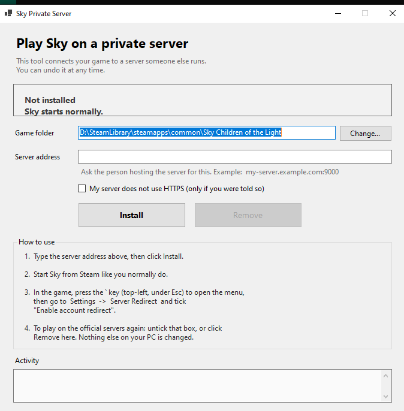

# Sky Private Server Client

A small Windows tool that points **Sky: Children of the Light** (Steam / PC) at a
private server, with a switch to go back to the official servers at any time.

- **SkySwitch.exe** — a plain Windows app: pick the server address, click *Install*.
- **winhttp.dll** — the mod loader it installs, with the server redirect built in.
- **In-game menu** — press `` ` `` → *Settings → Server Redirect* to change the
  address or turn the redirect on/off without touching files.

> **Unofficial fan project.** Not affiliated with thatgamecompany.
> Modding the client breaks the game's Terms of Service and can get your account
> banned. Use it at your own risk, and only with a server you trust.



---

## Quick start

1. Download **`SkySwitch.exe`** from the top of this repository (or build it,
   see below).
2. Run it. It finds your Sky folder automatically via Steam.
3. Type the server address you were given (e.g. `my-server.example.com:9000`)
   and click **Install**.
4. Start Sky from Steam.
5. In game press `` ` `` (top-left, under `Esc`) → **Settings → Server Redirect**
   → tick **Enable account redirect**.
6. To go back to the official servers: untick that box, or click **Remove** in
   SkySwitch. Nothing else on your PC is modified.

**Requirements:** Windows 10/11 x64 and the
[.NET 8 Desktop Runtime](https://dotnet.microsoft.com/download/dotnet/8.0).

---

## What it actually does

Sky talks to two hosts — `live.radiance.thatgamecompany.com` over HTTPS and
`live.ws.radiance.thatgamecompany.com` for the WebSocket. The loader hooks the
two functions that build those requests and rewrites the destination host when
it exactly matches the configured `from` host:

| Hook | What it sees | `from` key | What changes |
|---|---|---|---|
| `HttpClient::Request` | `Net::Uri { protocol, domain, port, path }` | `account_from` | `domain` + `port` |
| `AccountServerWebSocket::Connect` | `https://host[:port]/account/ws` | `ws_from` | URL string + host argument |

Everything else (CDN, analytics, shop) is left alone unless `force_http` is on.

Settings live in `<game>\htmodloader\options.json`:

```json
{
  "redirect": {
    "enabled": true,
    "force_http": false,
    "account_from": "live.radiance.thatgamecompany.com",
    "ws_from": "live.ws.radiance.thatgamecompany.com",
    "host": "my-server.example.com:9000"
  }
}
```

### What it does *not* do

In-room player sync uses **ENet over UDP**. That address is handed out by your
server (`gameUri`), not by the client, and it must be a reachable `IP:port` —
the client cannot resolve hostnames for ENet, and Cloudflare-style HTTP tunnels
do not carry UDP. Account login, friends, quests and shops go over HTTP/WSS and
work through a tunnel; multiplayer sync does not.

---

## Repository layout

```
installer/           SkySwitch — C# WinForms app (embeds the loader payload)
  payload/           winhttp.dll + html-config.json that get copied into the game
loader/              the modded loader — everything needed to build it
  html-sky/          full HTML-Sky source (vendored), includes the redirect
  patches/           reference diffs against upstream HTML-Sky and leveldb-mcpe
scripts/             helper scripts
licenses/            third-party license texts
```

---

## Building

### Installer

```powershell
dotnet publish installer/SkySwitch.csproj -c Release -r win-x64 `
  --self-contained false -p:PublishSingleFile=true -o dist
```

Produces a single `dist/SkySwitch.exe` (payload is embedded). Or run
`scripts/build-installer.ps1`.

### Loader (`winhttp.dll`)

Requires **MinGW-w64 15.1.0 with the win32 threading model (UCRT)**. The full
modified source, leveldb archive and all dependencies are in `loader/html-sky/`,
so no external clone is needed:

```powershell
cd loader/html-sky
mingw32-make all                       # -> dist/winhttp.dll
cp dist/winhttp.dll ../../installer/payload/winhttp.dll
```

Then rebuild the installer. Details, gotchas (a posix-threads toolchain builds
fine but deadlocks the game) and how to refresh the signatures live in
[`loader/README.md`](loader/README.md).

---

## Troubleshooting

| Symptom | Cause |
|---|---|
| No in-game menu | The loader didn't attach — usually the game updated and the byte signatures no longer match. Rebuild against the current game build. |
| Panel shows, login still hits official | `from` host is wrong for your game build, or the redirect is not enabled. |
| Login fails / hangs | Wrong `host`, or the server speaks plain HTTP while `force_http` is `false` (or vice versa). |
| Login works, nobody else in the world | UDP/ENet room traffic isn't routed (see above). |
| Game crashes at launch | Something else is already hooking the same functions — remove the standalone `sslpatch` mod if it is installed. |
| Window opens then freezes (0% CPU, all threads waiting) | The loader was built with a posix-threads MinGW. Rebuild with the win32-threads toolchain (see `loader/README.md`). |

Diagnostics are written by the loader; check the game folder for
`htmodloader\` contents and the loader log.

### Version note

The hook signatures in `loader/patches/0001-*.patch` target **Sky 0.35.1**.
After a game update they may stop matching; the loader will simply not redirect
until they are refreshed.

---

## Credits

- **[HT's Mod Loader (HTML-Sky)](https://github.com/HTMonkeyG/HTML-Sky)** by
  HTMonkeyG — MIT — the loader this is built on.
- **[sslpatch](https://github.com/that-sky-project/that-sky-patch-ssl)** by
  Thexiaoyu — AGPL-3.0 — the redirect hook design and
  `Net::Uri` layout this code is derived from.
- **[leveldb-mcpe](https://github.com/extremeheat/leveldb-mcpe)** and **LevelDB** —
  BSD — storage used by the loader.
- **zlib** — zlib license.
- SkySwitch and the redirect integration: MIT (see `LICENSE`).

Because the loader incorporates code derived from sslpatch (AGPL-3.0), the
loader sources **and the distributed `winhttp.dll` are AGPL-3.0**. The full
corresponding source is in this repository (`loader/` patches plus the pinned
upstream commit). See [`licenses/THIRD-PARTY.md`](licenses/THIRD-PARTY.md).

---

## Disclaimer

This project exists for research and personal use with privately hosted servers.
It is not affiliated with, endorsed by, or supported by thatgamecompany. You are
responsible for complying with the game's Terms of Service and local law.
